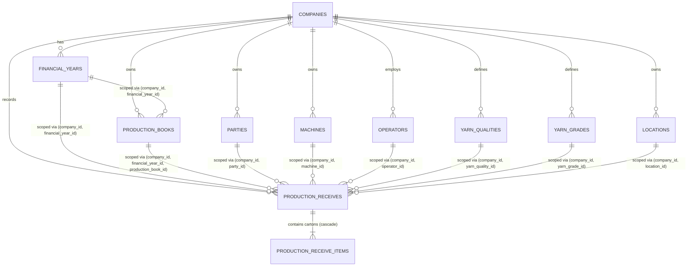

# Complete Database Architecture — Business Management System (BMS)

**Project:** Business Management System  
**Business:** SHIVAM ENTERPRISE  
**Database Engine:** PostgreSQL 18  
**ORM:** Prisma ORM  
**Phase:** Phase 2 (Complete Database Architecture)  

---

## 1. Executive Summary & Design Principles

The BMS database architecture is engineered specifically for **Shivam Enterprise** to provide high-performance, rock-solid data integrity for manufacturing and business accounting operations on local on-premises hardware (Windows 10, AMD E2-9000, 4 GB RAM).

### Core Architectural Pillars
1. **Multi-Tenant (Company-Level) Data Isolation:** Every master entity, setting, transaction, and balance is strictly scoped to a `company_id`. No entity can be leaked or cross-referenced between companies.
2. **Financial-Year-Level Partitioning & Continuity:** Every transactional document (Production Challans, Invoices, Ledgers) belongs to a specific `financial_year_id`. Financial years can be cleanly opened, closed, or locked without disturbing historical transactions.
3. **Numeric Precision (No Float Drift):** All weight values (Carton Weight, Cops Weight, Tare Weight, Net Weight, Average Weight) and monetary values (Opening Balance, Balances) use PostgreSQL exact `DECIMAL` / `NUMERIC` types (`DECIMAL(10, 3)` for weights to the exact gram, and `DECIMAL(15, 2)` for currency).
4. **Strong Referential Integrity:** Foreign keys use `ON DELETE RESTRICT` for primary parent documents to prevent accidental cascading deletion of live financial or manufacturing records, and `ON DELETE CASCADE` for tightly-coupled sub-items (e.g. `ProductionReceiveItem`).

---

## 2. Entity Relationship Diagram (ERD)

---

## 2.1 Database Integrity Hardening (Phase 2.1)

### A. Financial Year Overlap Prevention Trigger
To prevent temporal corruption or double-booking across fiscal periods, PostgreSQL enforces an automated database trigger: `trg_check_financial_year_overlap` attached to `BEFORE INSERT OR UPDATE ON financial_years`.
- **Chronology Check:** Enforces `start_date < end_date`.
- **Overlap Prevention:** Rejects any `NEW.start_date <= end_date AND NEW.end_date >= start_date` within the same `company_id`.
- **Consecutive Support:** Allows exact day-boundary consecutive years (e.g. Year 1 ending 2025-03-31 23:59:59 and Year 2 starting 2025-04-01 00:00:00).
- **Multi-Company Independence:** Multiple companies can declare identical calendar dates (e.g. 2025-04-01 to 2026-03-31) simultaneously without interference.

### B. Composite Foreign Key Architecture (Cross-Company Isolation)
Rather than simple single-column IDs, all foreign keys between transactional records and masters are **Composite Foreign Keys**:
- `production_books`: `FOREIGN KEY (company_id, financial_year_id) REFERENCES financial_years(company_id, id)`
- `production_receives`: `FOREIGN KEY (company_id, financial_year_id) REFERENCES financial_years(company_id, id)`
- `production_receives`: `FOREIGN KEY (company_id, financial_year_id, production_book_id) REFERENCES production_books(company_id, financial_year_id, id)`
- `production_receives`: `FOREIGN KEY (company_id, party_id) REFERENCES parties(company_id, id)`
- `production_receives`: `FOREIGN KEY (company_id, machine_id) REFERENCES machines(company_id, id)`
- `production_receives`: `FOREIGN KEY (company_id, operator_id) REFERENCES operators(company_id, id)`
- `production_receives`: `FOREIGN KEY (company_id, yarn_quality_id) REFERENCES yarn_qualities(company_id, id)`
- `production_receives`: `FOREIGN KEY (company_id, yarn_grade_id) REFERENCES yarn_grades(company_id, id)`
- `production_receives`: `FOREIGN KEY (company_id, location_id) REFERENCES locations(company_id, id)`

**Guarantee:** It is mathematically and relationally impossible at the PostgreSQL engine level for a production voucher of Company A to link to a Party, Machine, Operator, Location, Quality, Grade, or Production Book belonging to Company B.

---

## 3. Data Dictionary & Model Specifications

### 3.1 Company Management (`companies`)
Houses the legal and operational details of each registered enterprise.
- `id` (UUID, PK): Unique system identifier.
- `company_code` (VARCHAR, UNIQUE): Business code (e.g., `SHIVAM01`).
- `company_name` (VARCHAR): Legal entity name.
- `gstin` (VARCHAR, Nullable): 15-character GST identification number.
- `pan_number` (VARCHAR, Nullable): Income Tax PAN.
- `address`, `city`, `state`, `pincode`: Full operational address.
- `phone`, `email`: Contact details.
- `logo_path` (VARCHAR, Nullable): Path to stored logo asset.
- `is_active` (BOOLEAN, Default: `true`): Soft enable/disable flag.

### 3.2 Financial Year (`financial_years`)
Manages fiscal periods per company.
- `id` (UUID, PK): Unique identifier.
- `company_id` (UUID, FK -> `companies.id`): Enforces company tenancy.
- `year_name` (VARCHAR): E.g., `"2025-2026"`.
- `start_date` (TIMESTAMP): Fiscal start (e.g., `2025-04-01`).
- `end_date` (TIMESTAMP): Fiscal end (e.g., `2026-03-31`).
- `is_active` (BOOLEAN): Current active operational year.
- `is_locked` (BOOLEAN): Year closure lock preventing retroactive edits.
- **Constraints & Indexes:**
  - `UNIQUE(company_id, year_name)`: Guarantees no duplicate fiscal years for a company.
  - `INDEX(company_id, is_active)`: Rapid lookup of active fiscal context.

### 3.3 Master Models

#### `parties` (Customers, Suppliers, Job Workers)
- `id` (UUID, PK)
- `company_id` (UUID, FK)
- `party_code` (VARCHAR): Scoped unique code (e.g., `CUST001`).
- `party_name` (VARCHAR): Legal party title.
- `party_type` (ENUM: `CUSTOMER`, `SUPPLIER`, `BOTH`).
- `opening_balance` (`DECIMAL(15, 2)`): Initial balance at account creation.
- `balance_type` (ENUM: `DEBIT`, `CREDIT`).
- **Constraints:** `UNIQUE(company_id, party_code)`.

#### `machines` (Twisting, Winding, Texturizing Equipment)
- `id` (UUID, PK)
- `company_id` (UUID, FK)
- `machine_code` (VARCHAR): Unique identifier (e.g., `TFO-01`).
- `machine_name` (VARCHAR): Equipment description.
- **Constraints:** `UNIQUE(company_id, machine_code)`.

#### `operators` (Shift Technicians & Machine Operators)
- `id` (UUID, PK)
- `company_id` (UUID, FK)
- `operator_code` (VARCHAR): Unique badge/employee code (e.g., `OP-101`).
- `operator_name` (VARCHAR): Full name.
- **Constraints:** `UNIQUE(company_id, operator_code)`.

#### `locations` (Godowns, Warehouses, Floors)
- `id` (UUID, PK)
- `company_id` (UUID, FK)
- `location_name` (VARCHAR): Warehouse name (e.g., `Godown 1 - Section A`).
- **Constraints:** `UNIQUE(company_id, location_name)`.

#### `yarn_qualities` (Yarn Denier & Filament Specifications)
- `id` (UUID, PK)
- `company_id` (UUID, FK)
- `quality_name` (VARCHAR): E.g., `80/72 Polyester DTY Texturised`.
- `denier` (VARCHAR, Nullable): Denier / Filament details.
- **Constraints:** `UNIQUE(company_id, quality_name)`.

#### `yarn_grades` (Quality Classification)
- `id` (UUID, PK)
- `company_id` (UUID, FK)
- `grade_name` (VARCHAR): E.g., `A-Grade`, `B-Grade`, `Fresh`, `Reject`.
- **Constraints:** `UNIQUE(company_id, grade_name)`.

#### `production_books` (Production Voucher Registers)
- `id` (UUID, PK)
- `company_id` (UUID, FK)
- `financial_year_id` (UUID, FK)
- `prefix` (VARCHAR): Challan series prefix (e.g., `PR-25`).
- `book_name` (VARCHAR): E.g., `Main Production Receive Book`.
- `opening_balance` (`DECIMAL(15, 3)`): Initial volume balance.
- **Constraints:**
  - `UNIQUE(company_id, financial_year_id, book_name)`
  - `UNIQUE(company_id, financial_year_id, prefix)`

---

## 4. Manufacturing & Production Receive Architecture

### 4.1 Production Receive Header (`production_receives`)
Represents the official production voucher / challan document.
- `id` (UUID, PK)
- `company_id` (UUID, FK -> `companies.id`, ON DELETE RESTRICT)
- `financial_year_id` (UUID, FK -> `financial_years.id`, ON DELETE RESTRICT)
- `production_book_id` (UUID, FK -> `production_books.id`, ON DELETE RESTRICT)
- `challan_number` (VARCHAR): Document number (e.g., `1001`).
- `challan_date` (TIMESTAMP): Date of production receipt.
- `party_id` (UUID, FK, Nullable -> `parties.id`): Party or job worker.
- `machine_id` (UUID, FK, Nullable -> `machines.id`): Producing equipment.
- `operator_id` (UUID, FK, Nullable -> `operators.id`): Responsible operator.
- `yarn_quality_id` (UUID, FK, Nullable -> `yarn_qualities.id`): Item quality.
- `yarn_grade_id` (UUID, FK, Nullable -> `yarn_grades.id`): Grade classification.
- `lot_number` (VARCHAR, Nullable): Manufacturing batch/lot number.
- `twist` (VARCHAR, Nullable): Twist specification (e.g., `250 TPM S-Twist`).
- `empty_cops_weight` (`DECIMAL(10, 3)`): Tare weight per empty cop in kg (e.g., `0.050`).
- `location_id` (UUID, FK, Nullable -> `locations.id`): Stored warehouse.
- `status` (ENUM: `DRAFT`, `CONFIRMED`, `CANCELLED`).
- **Constraints & Indexes:**
  - `UNIQUE(company_id, financial_year_id, production_book_id, challan_number)`: Guarantees document number uniqueness per book and financial year.
  - `INDEX(company_id, financial_year_id, challan_date)`: Fast date-range filtering.

### 4.2 Production Receive Items (`production_receive_items`)
Contains individual carton weights, cop counts, and calculations.
- `id` (UUID, PK)
- `production_receive_id` (UUID, FK -> `production_receives.id`, ON DELETE CASCADE)
- `carton_number` (VARCHAR): Sequential carton number (e.g., `1`, `2`, `3`).
- `cartonWeight` (`DECIMAL(10, 3)`): Tare weight of the empty outer carton box (kg).
- `cops` (INTEGER): Number of yarn cops / bobbins inside the carton.
- `grossWeight` (`DECIMAL(10, 3)`): Total scale weight (Carton + Cops + Yarn) (kg).
- `copsWeight` (`DECIMAL(10, 3)`): Total weight of empty cops (`cops * empty_cops_weight`) (kg).
- `tareWeight` (`DECIMAL(10, 3)`): Total tare weight (`cartonWeight + copsWeight`) (kg).
- `netWeight` (`DECIMAL(10, 3)`): Pure yarn weight (`grossWeight - tareWeight`) (kg).
- `averageWeight` (`DECIMAL(10, 3)`): Average weight per cop (`netWeight / cops`) (kg).
- `twist`, `lot_number`, `grade`: Optional line-item overrides.
- **Constraints:** `UNIQUE(production_receive_id, carton_number)`.

---

## 5. Weight Calculation Rules (Provisional Business Logic)

Based on reference software behavior, the provisional formulas are defined as:
$$\text{Cops Weight} = \text{Cops} \times \text{Empty Cops Weight}$$
$$\text{Tare Weight} = \text{Carton Weight} + \text{Cops Weight}$$
$$\text{Net Weight} = \text{Gross Weight} - \text{Tare Weight}$$
$$\text{Average Weight} = \frac{\text{Net Weight}}{\text{Cops}}$$

All weights are rounded and stored to 3 decimal places (accurate to 1 gram: `0.001 kg`).

---

## 6. Future Expansion Roadmap

The schema structure directly prepares for upcoming enterprise modules:
- **Sales & Dispatch:** `sales_invoices`, `delivery_challans` (linking to `company_id`, `financial_year_id`, `party_id`).
- **Purchases:** `purchase_bills`, `purchase_returns` (raw yarn & supplies).
- **Inventory Stock Ledgers:** `stock_ledgers` (FIFO/weighted-average inventory tracking by quality and lot).
- **Accounting & GST:** `vouchers`, `ledger_accounts`, `gstr1_summaries` (linked to `company_id` and `financial_year_id`).

